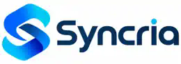

  

# Syncria

**Keep your files together, wherever you save them.**

**Interface (v0.7.0):** Syncria uses a quieter, locally bundled Tailwind CSS design with straightforward navigation, forms, progress, and storage management. No browser CDN or external UI service is needed.

Syncria helps you keep folders matched between Google Drive, Dropbox, and storage boxes on your home or work network. Those storage boxes are called **NAS devices**.

For example, you can have family photos in Google Drive and keep a matching copy on your NAS. Or you can keep two NAS boxes matched without using the cloud at all.

Syncria does not become another place that stores your files. Your files stay in your cloud account or on your NAS.

## Getting started

You don't need to know networking terms to use Syncria's everyday screens. Once Syncria is installed, open it in your browser and follow these steps:

1. **Cloud Accounts:** If your files are in Google Drive or Dropbox, connect the account you use. If you're only copying between NAS boxes, skip this step.
2. **My NAS Boxes:** Add the storage box you want to use. You'll need its network address, shared folder name, username and password.
3. **My Syncs → Set up a sync:** Choose **where your files are now**, **where copies should go**, and **how often Syncria should check**. Read the final summary and save it.
4. **Turn on sync:** New syncs start **off**, so they will not copy anything automatically. You can turn a sync on or choose **Sync now** when you're ready.

For examples and explanations of common choices, read [Getting Started](docs/GETTING-STARTED.md).

## What can Syncria do?

- **Google Drive ↔ NAS:** Keep cloud files and a NAS folder matched.
- **Dropbox ↔ NAS:** Do the same with a Dropbox account.
- **NAS ↔ NAS:** Keep folders on separate NAS devices together, without needing any cloud account.
- **More than one account or NAS:** Set up separate syncs for different family members or devices.
- **One way or both ways:** For NAS-to-NAS syncs, decide whether changes travel in one direction or both.
- **Handle two different copies:** When the same file was changed on both NAS boxes, you can tell Syncria to ask you, use the newer copy, choose one NAS, or keep both copies.
- **Bring back an accidental deletion:** By default, Syncria gives you a **10-minute Undo window** after it finds a deletion, when the storage service supports recovery. You can change the deletion settings for each sync.

### Important things to know

**A sync is not a separate backup.** If you delete a file and deletion sharing is on, Syncria can remove its matching copies too. Keep an independent backup of files you cannot replace.

**The 10-minute clock starts when Syncria detects the deletion**, which may be later than when you pressed Delete. Recovery depends on the storage service being available. Syncria does not secretly save your files on its server.

**The app will not automatically overwrite a file it cannot safely handle.** Some cloud-native items, shared drives, shortcuts, and complicated moves need special care. If a file cannot be handled safely, you should see a problem instead of a false success.

## Live synchronization

Syncria shows one shared live status across Overview, My Syncs, and Activity. The interface uses an authenticated, same-origin event stream to report folder scanning, filenames discovered, transfer direction, operations completed, and failures as they happen. If a reverse proxy does not support streaming, Syncria falls back to frequently refreshed status snapshots. All data comes from the current sync process, not estimates or demonstration values.

**Activity** shows actual file operations across all relationships; the latest 100 operations per sync are saved when a run ends, so they remain visible after a restart. You can still use **Test run · Preview changes** if you want a read-only safety check before executing. A preview is not required to see live sync data.

### Names that contain slashes

Google Drive can have a single file or folder *name* containing a literal slash, such as `Bland, Mike - Security Camera/P2P Setup`. An SMB/NAS cannot represent that slash within one filename. Syncria now maps that individual Drive name into a unique, reversible NAS-safe component with a reserved `~syncria~` prefix and URL-safe encoding, while retaining its original Drive ID and name. Normal names are unchanged. When creating a file or folder back on Drive, Syncria restores the original name.

**Do not manually rename these encoded NAS entries** if you expect a bidirectional relationship to continue matching the same Drive item. Google Drive siblings whose names still collide on a case-insensitive NAS stop safely rather than overwriting one another. The sidecar `sync.ffs_db` remains excluded from replication.

## Editing a sync and choosing its direction

On **My Syncs**, select **Edit sync** to change an existing cloud-to-NAS or NAS-to-NAS relationship. Syncria preloads the current account, source and destination folders, schedule, conflict settings, and deletion recovery preferences. Pause automatic syncing and wait for any active run to finish before saving changes.

A change to name, schedule, sync direction, or conflict/deletion rules preserves the relationship identity, run history, and file comparison checkpoints. A change to an account, source, destination, folder, or the ordering of destination NAS boxes requires explicit confirmation of a new comparison baseline. This clears old file checkpoints rather than applying them to different locations, and saving **does not transfer, delete, or rename any user files**. Do not change endpoints while deletion recovery is pending.

Cloud-to-NAS relationships support **Both ways: cloud ↔ NAS** (the legacy default) or **One way: cloud → NAS**. One way means the cloud wins if content differs: NAS edits will not go back to the cloud, and an existing NAS copy may be overwritten by the cloud copy. Confirm the preview before enabling it. NAS-to-NAS has its own direction and conflict controls; the existing one-way NAS conflict safeguards remain in place.

## Previewing and understanding a sync

Open **My Syncs** and choose **Test run · Preview changes** on a sync. Syncria reads both locations without copying or deleting files. You can inspect the planned file-by-file actions, see the named source and destination of each transfer, and identify conflicts or deletions before a real run.

The preview is a read-only estimate based on the current scan. During a first cloud-to-NAS sync, if both locations contain the same file path, Syncria proposes the copy with the newer modification timestamp, shows both timestamps, and labels the proposed timestamp-based replacement **Replace**. The real sync uses modification timestamps and size metadata without reading file contents merely to decide whether a transfer is needed; ambiguous metadata requires review. The first-run preference can be changed to manual in the cloud sync wizard. Be aware that moving a file between NAS devices can reset its timestamp, so newer does not always mean better. The view includes counts across the complete scan and up to 500 file rows. A live sync shows the current filename and a recent history of up to 100 **actual** operations.

**FreeFileSync interoperability:** Syncria intentionally excludes the exact filename `sync.ffs_db` (case-insensitive) from all connected storage types and from legacy sync checkpoints. A prior failure message remains labeled as the last failed run until a newer sync completes. This file is FreeFileSync's private comparison database, and Google Drive can hold multiple copies with that name. Existing copies are left untouched in their original location. Other filenames, including other `.ffs_db` files, are not silently excluded. Drive sibling files with the same name are represented on NAS using distinct, stable names derived from their Drive IDs. Existing Drive files are not renamed.

## Updating Syncria

You normally update from **inside Syncria**:

1. Open **App Updates**.
2. Click **Check for updates**.
3. Click **Download and install** when a verified update is available.
4. Watch the real download and checking progress. Syncria will restart and confirm the new version.

Your saved accounts, NAS boxes, and sync choices remain in place. You do **not** need to build an app, download a replacement image, or add an extra updater container each time.

## Installing Syncria for the first time

Syncria is self-hosted. An adult or person who manages your home server will need to install it once. After that, most actions happen in the browser.

The repository includes a [Docker Compose configuration](compose.yaml) and [Dockerfile](Dockerfile); standalone binaries are attached to [GitHub Releases](https://github.com/gigabytegrove/syncria/releases). The Compose image depends on GitHub Container Registry access, which may be restricted while package-publishing permissions are being resolved. If the image cannot be pulled, do not assume the app is broken.

[Technical installation instructions and older release details](docs/TECHNICAL.md) are available for whoever manages the server. The **in-app updater** is still the main way to update an existing installation.

## Need help?

[Getting Started](docs/GETTING-STARTED.md) explains the everyday screens, common choices, and what to check when a connection fails.

[Latest changes](docs/RELEASE-v0.6.0.md) explains what's different in the newest version without developer jargon.

[Technical reference](docs/TECHNICAL.md) keeps advanced deployment, API, security, and release history details for administrators.

**Made by [Gigabyte Grove](https://github.com/gigabytegrove).**